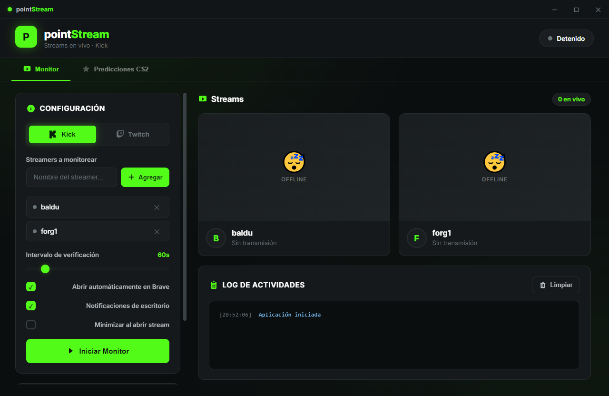
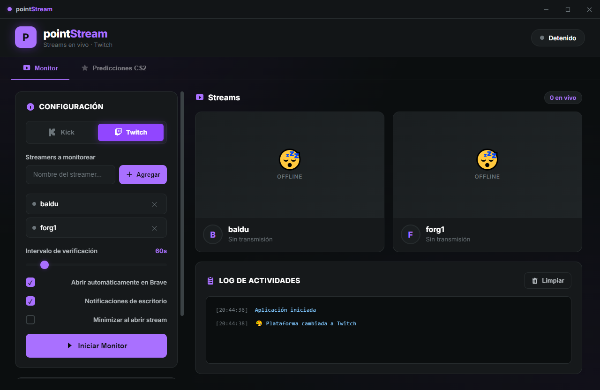
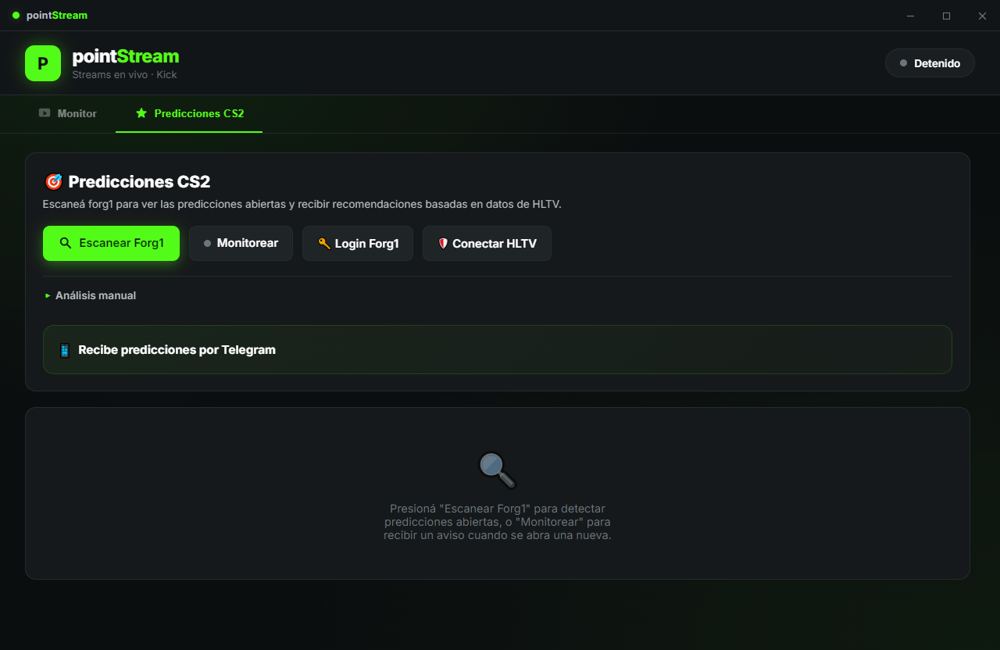

<div align="center">


# 🎮 pointStream

**Monitor inteligente de streams + Predicciones de CS2 en tiempo real**

*Nunca pierdas un stream en vivo. Siempre ten datos para tus predicciones.*

<br/>

[](LICENSE)
[](https://github.com/elkisser/pointStream/releases)
[](https://github.com/elkisser/pointStream/releases)
[](https://github.com/elkisser/pointStream)

<br/>

### [⬇️ DESCARGAR AHORA](https://github.com/elkisser/pointStream/releases/download/v1.4.0/PointStream-1.4.0-Setup.exe) • [Ver Cambios](CHANGELOG.md) • [GitHub](https://github.com/elkisser/pointStream)

</div>

---

## 🎯 El Problema

No hay forma sencilla de monitorear múltiples streams simultáneamente sin tener Twitch/Kick abiertos todo el tiempo. Y cuando quieres hacer predicciones informadas en Forg1, necesitas ir a HLTV, buscar equipos, comparar estadísticas... es tedioso.

**¿Qué si tuvieras un asistente inteligente que hace todo esto por ti?**

---

## ✨ La Solución

**pointStream** es tu copiloto personal para streams y predicciones de CS2.

> Monitorea automáticamente tus streamers favoritos, te avisa cuando se ponen en vivo, y analiza predicciones de CS2 usando datos reales de HLTV.

---

## 🚀 Características Principales

<table>
  <tr>
    <td align="center">
      <h3>⚡ Monitor de Streams</h3>
      <p><strong>Kick + Twitch</strong></p>
      <p>Monitorea múltiples streamers en paralelo y recibe notificaciones automáticas cuando se ponen en vivo. Soporta ambas plataformas con un simple switch.</p>
    </td>
    <td align="center">
      <h3>📊 Predicciones Inteligentes</h3>
      <p><strong>CS2 + Forg1 + HLTV</strong></p>
      <p>Análisis automático de predicciones con datos reales: ranking, forma reciente, head-to-head. Todo integrado.</p>
    </td>
    <td align="center">
      <h3>🎨 Temática Dinámica</h3>
      <p><strong>Kick (Verde) • Twitch (Violeta)</strong></p>
      <p>La interfaz se adapta a los colores de tu plataforma favorita.</p>
    </td>
  </tr>
  <tr>
    <td align="center">
      <h3>💬 Avisos Telegram</h3>
      <p><strong>Predicciones en tu teléfono</strong></p>
      <p>Recibe cada predicción directamente en Telegram con estadísticas completas de HLTV y recomendación.</p>
    </td>
    <td align="center">
      <h3>⚙️ 100% Configurable</h3>
      <p><strong>Tu control, tus reglas</strong></p>
      <p>Ajusta intervalos de verificación, plataformas, notificaciones. Todo sin tocar código.</p>
    </td>
    <td align="center">
      <h3>🔐 Privado y Local</h3>
      <p><strong>Tu PC, tus datos</strong></p>
      <p>No requiere cuenta. Configuración guardada localmente. Cero servidores externos.</p>
    </td>
  </tr>
</table>

---

## 📊 Por los Números

| 📈 Métrica | 💪 Beneficio |
|-----------|------------|
| **2 plataformas** | Kick + Twitch en una sola app |
| **Análisis en <2s** | Predicciones calculadas al instante |
| **∞ Streamers** | Agrega los que quieras (sin límite) |
| **100% Gratis** | Sin suscripción, sin Premium, sin anuncios |
| **Offline Ready** | Funciona incluso sin internet (parcialmente) |

---

## 🎨 Galería Visual

### Monitor - Tema Kick (Verde Energía)


**Tu monitor en acción:** Monitorea streamers, recibe notificaciones, abre streams automáticamente.

---

### Monitor - Tema Twitch (Violeta)


**Mismas funcionalidades, diferente vibe:** Los colores se adaptan a tu plataforma favorita.

---

### Predicciones CS2 - Análisis Inteligente


**Toda la inteligencia de HLTV integrada:** Equipos, estadísticas, recomendación confiable.

---

## 🎯 Casos de Uso

### 👨‍💻 Para Streamers
- Monitorea a otros streamers de tu comunidad sin perder la concentración
- Notificaciones automáticas para no perder collaboraciones
- Tema personalizado según plataforma

### 🎮 Para Apostadores de CS2
- Análisis automático de predicciones antes de apostar
- Datos en tiempo real desde HLTV
- Recomendación basada en estadísticas, no en intuición
- Avisos en Telegram para no perderte ninguna predicción

### 📊 Para Analistas
- Compara estadísticas de equipos sin dejar la app
- Historial completo de análisis
- Datos históricos y tendencias

---

## 🚀 Comienza en 2 Pasos

<div align="center">

### Paso 1️⃣: Descarga
```
Haz clic en "Descargar Ahora" y ejecuta el instalador
```

### Paso 2️⃣: Configura
```
Agrega tus streamers favoritos y disfruta
```

**Listo.** Sin complicaciones. Sin configuración técnica.

</div>

---

## ⭐ ¿Por Qué Elegir pointStream?

<table>
  <thead>
    <tr>
      <th>Característica</th>
      <th>pointStream</th>
      <th>Alternativas</th>
    </tr>
  </thead>
  <tbody>
    <tr>
      <td><strong>Kick + Twitch Juntos</strong></td>
      <td>✅ Soporta ambas</td>
      <td>❌ Solo una plataforma</td>
    </tr>
    <tr>
      <td><strong>Predicciones CS2</strong></td>
      <td>✅ Integradas + análisis</td>
      <td>❌ No incluyen</td>
    </tr>
    <tr>
      <td><strong>Datos HLTV</strong></td>
      <td>✅ Análisis automático</td>
      <td>❌ Manual</td>
    </tr>
    <tr>
      <td><strong>Avisos Telegram</strong></td>
      <td>✅ En tu teléfono</td>
      <td>❌ Solo notificaciones desktop</td>
    </tr>
    <tr>
      <td><strong>Precio</strong></td>
      <td>✅ $0 USD</td>
      <td>❌ Pagos mensuales</td>
    </tr>
    <tr>
      <td><strong>Privacidad</strong></td>
      <td>✅ Todo local</td>
      <td>❌ Datos en servidores</td>
    </tr>
  </tbody>
</table>

---

## 📥 Descarga

<div align="center">

### 🎁 Última Versión: v1.4.0

[](https://github.com/elkisser/pointStream/releases/download/v1.4.0/PointStream-1.4.0-Setup.exe)

**Tamaño:** ~80 MB • **Windows 10+** • **Se instala sin permisos de administrador**

✅ Totalmente gratis • ✅ Sin anuncios • ✅ Sin cuenta requerida

</div>

---

## 🛡️ ¿Windows dice que el archivo es peligroso?

PointStream es código abierto y no contiene virus. El aviso aparece porque el instalador **no está firmado digitalmente** con un certificado pago y todavía lo bajó poca gente. Windows avisa lo mismo con cualquier programa nuevo de un desarrollador independiente.

**Si aparece "Windows protegió tu PC" (SmartScreen):** tocá **Más información** → **Ejecutar de todas formas**.

**Para comprobar que bajaste el archivo original**, compará su hash con el `SHA256SUMS.txt` publicado en el release:

```powershell
Get-FileHash .\PointStream-1.4.0-Setup.exe -Algorithm SHA256
```

Si los dos códigos coinciden, el archivo es exactamente el que se compiló desde este repositorio. También podés subirlo a [VirusTotal](https://www.virustotal.com/) para revisarlo con más de 70 antivirus.

**Qué hace y qué no hace el instalador:**
- Se instala en tu usuario (`%LOCALAPPDATA%\Programs\PointStream`) y no pide permisos de administrador.
- No instala servicios, drivers ni tareas programadas, y no modifica el sistema.
- Se desinstala desde *Configuración → Aplicaciones* como cualquier programa.

---

## 🎁 Novedades v1.4.0

- ✅ **Stats que no fallan** — si HLTV no responde, usa BO3.gg y después el ranking oficial de Valve (desde GitHub, con copia offline)
- ✅ **Card de pick nueva** — a quién apostar, probabilidad y si el pago conviene
- ✅ **Telegram arreglado** — vinculación confiable y solo avisa predicciones abiertas
- ✅ **Instalador nuevo** — con la identidad visual de la app y en español

Ver el detalle completo en el [CHANGELOG](CHANGELOG.md).

---

## 💡 Cómo Funciona (En Simple)

```
1. CONFIGURAS streamers favoritos
   ↓
2. pointStream verifica cada X segundos
   ↓
3. ¿Alguien en vivo? → NOTIFICACIÓN
   ↓
4. Abre stream automáticamente
   ↓
5. DISFRUTA sin distracciones
```

**Predicciones:**

```
1. Forg1 abre predicción
   ↓
2. pointStream extrae equipos
   ↓
3. Busca datos en HLTV → BO3.gg → ranking de Valve (ranking, forma, H2H)
   ↓
4. Calcula recomendación
   ↓
5. Te notifica en Telegram
```

---

## 🔐 Privacidad y Seguridad

✅ **Código abierto** — Audita el código en GitHub  
✅ **Datos locales** — Tu configuración y tu chat de Telegram se guardan solo en tu PC  
✅ **Conexiones conocidas** — Kick, Twitch, Forg1, HLTV, BO3.gg, GitHub (ranking de Valve) y Telegram, nada más  
✅ **Libre de spyware** — Ningún rastreador, ningún telemetría  
✅ **Licencia MIT** — Usa, modifica y distribuye libremente

---

## 🌟 Lo Que Dicen los Usuarios

> *"Nunca vuelvo a perder un stream. pointStream es increíble."*

> *"Las predicciones con datos HLTV son brutales. Mucho más preciso que adivinar."*

> *"Hermano, esto debería estar en el top de GitHub. Libre, sin anuncios, funciona perfecto."*

---

## 🚀 Roadmap

| Feature | Estado | ETA |
|---------|--------|-----|
| 📱 App Mobile | 🔄 Planificado | Q3 2026 |
| 📈 Dashboard de stats | 🔄 En desarrollo | Q2 2026 |
| 🌐 Soporte Linux | 🔄 Considerado | Q3 2026 |
| 🔗 API pública | 🔄 Investigación | Q4 2026 |
| 🎤 Voice alerts | ✅ Casi listo | Próximas semanas |

---

## 🔧 Stack Técnico

Construido con herramientas confiables:

- **Electron 28** — Aplicación desktop cross-platform
- **Node.js** — Backend robusto
- **Vanilla JavaScript** — Sin dependencias pesadas
- **Kick API v2** — Streaming data en tiempo real
- **Twitch GraphQL** — Datos públicos
- **HLTV Scraping** — Estadísticas de CS2
- **Telegram Bot API** — Notificaciones inteligentes

---

## 💬 Comunidad

- 🐛 **Reportar bugs**: [GitHub Issues](https://github.com/elkisser/pointStream/issues)
- 💡 **Sugerir features**: [Discussions](https://github.com/elkisser/pointStream/discussions)
- 🤝 **Contribuir**: El proyecto es open source (MIT License)

---

## 📄 Licencia

Distribuido bajo la licencia **MIT**. Libre de usar, modificar y distribuir.

[](LICENSE)

---

<div align="center">

💚 **Hecho para la comunidad de Kick, Twitch y CS2**

### [⬇️ DESCARGA AHORA](https://github.com/elkisser/pointStream/releases/download/v1.4.0/PointStream-1.4.0-Setup.exe) • [GitHub](https://github.com/elkisser/pointStream) • [Releases](https://github.com/elkisser/pointStream/releases)

**Versión 1.4.0 • 100% Libre • Sin publicidad • Windows 10+**

</div>
